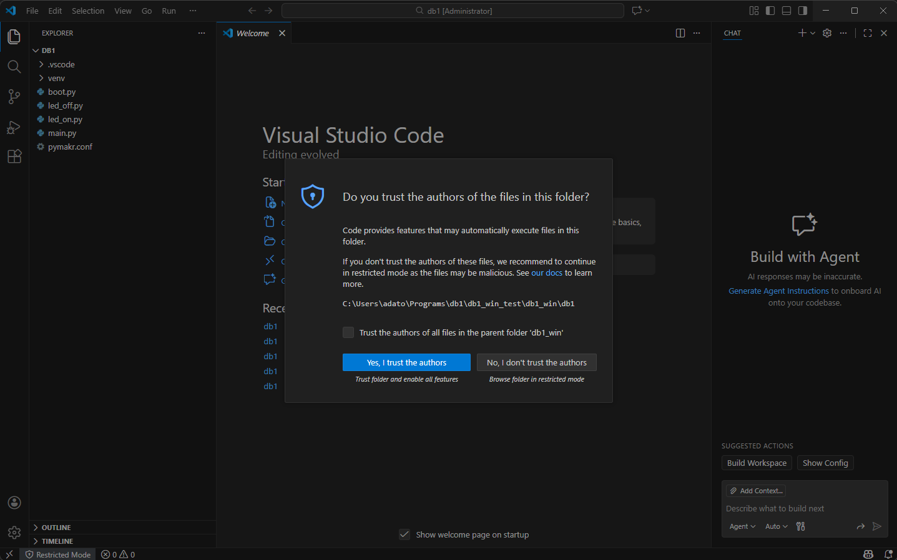

# Mac installation

This guide explains how to set up your Mac to program the **HUZZAH32** board in Visual Studio Code (VS Code). 
You will find a zip file in this folder called `db1_mac.zip`. This file contains installation scripts that will help you set up an environment to program with your HUZZAH32 board, monitor it while it is running and eventually download measurement data from it

## Before installation
The installation script will setup the working environment within itself. This is where you will send your programs to the device from and download the data from it. In other words, where you start your installation is where you will be working from for the rest of the course. 

Move the extracted `db1_mac` folder somewhere you want to keep it, such as your existing university coursework directory or Documents. Avoid protected system folders such as `/System/`, `/Library/` , `/Applications/`and, preferably, `/Downloads/`.

Keep the extracted bundle together: i includes `db1_install.sh`, `db1_doctor.sh`,`db1_uninstall.sh`, `huzzah32_factory_reset.sh`, the `db1` project folder, and the firmware file used for resetting the board. Do not move any scripts out of this folder!

## Installation

1. In Finder, locate `db1_mac.zip` and double-click it if it has not already been extracted.
2. Move the extracted `db1_mac` folder to your chosen coursework location.
3. Open the folder and find the installation scripts (see listed above).
Once in the installation folder, see the bar at the bottom of the window showing the path. Right click on the db1_mac directory and from the resulting menu, select "Open in terminal"


4. Run:

   ```bash
   bash db1_install.sh
   ```

A separate installer, such as Homebrew, may ask for administrator authorization. This is because the necessary programs can only be installed with administrator rights.

Installation may take several minutes. If macOS prompts you to install **Xcode Command Line Tools**, complete that installation and then run the command again.

The installation can take several minutes, so be patient. At the end, you should be provided a list of the installed components and their status similar to the one shown bellow. If everything went well, the installation script will launch a Visual Studio Code instance with a default project that is present in the db1 subdirectory of your installation folder. You can close the VS Code for now.

## Check that installation succeeded

Read the **Verification** section printed at the end of the installation. If it reports a **FAIL** or **WARN**, follow the accompanying message. The installer also saves a log named **`db1_install.log`** in the `db1_mac` folder. If you need help, grab a TA ;)

If the installer says it cannot write to the folder, move the entire extracted `db1_mac` folder to a location where you have permission to edit files, then try again.

## HUZZAH32 connection and factory reset

### USB connection and CP210x driver

Connect your HUZZAH32 to the Mac using a USB data cable. Some cables only provide power and cannot transfer data.

The HUZZAH32 uses a **Silicon Labs CP210x USB-to-UART interface** to communicate with the Mac. Your Mac must recognize this interface for the reset and programming tools to communicate with the board. 

Depending on your macOS version, the necessary support may already be available; installing a separate CP210x VCP driver is not automatically required on every Mac.
If you are having issues connecting to your board, try downloading and installing the appropriate drivers from here: [CP210x USB to UART Bridge VCP Drivers - Silicon Labs](https://www.silabs.com/software-and-tools/usb-to-uart-bridge-vcp-drivers)

Before resetting, check whether a port appears when you connect the board. In Terminal, run:

```bash
ls /dev/cu.*
```

Look for a port with a name similar to `/dev/cu.SLAB_USBtoUART` or `/dev/cu.usbserial-1234ABCD`. The exact name varies. If you are unsure which port belongs to the HUZZAH32, compare the list with the board unplugged and plugged in.

### Factory reset

Once the board is connected and a serial port is visible, return to Terminal in the `db1_mac` folder and run:

```bash
bash huzzah32_factory_reset.sh
```

## Using VS Code

Open **Visual Studio Code**, then choose **File → Open Folder…** and select the **`db1` subfolder inside `db1_mac`**. This is where you will edit the programs you upload to the HUZZAH32.

VS Code may ask whether you trust this folder. If you downloaded it from the official course materials, choose  “Yes, I trust the authors” — source: trust me bro.


