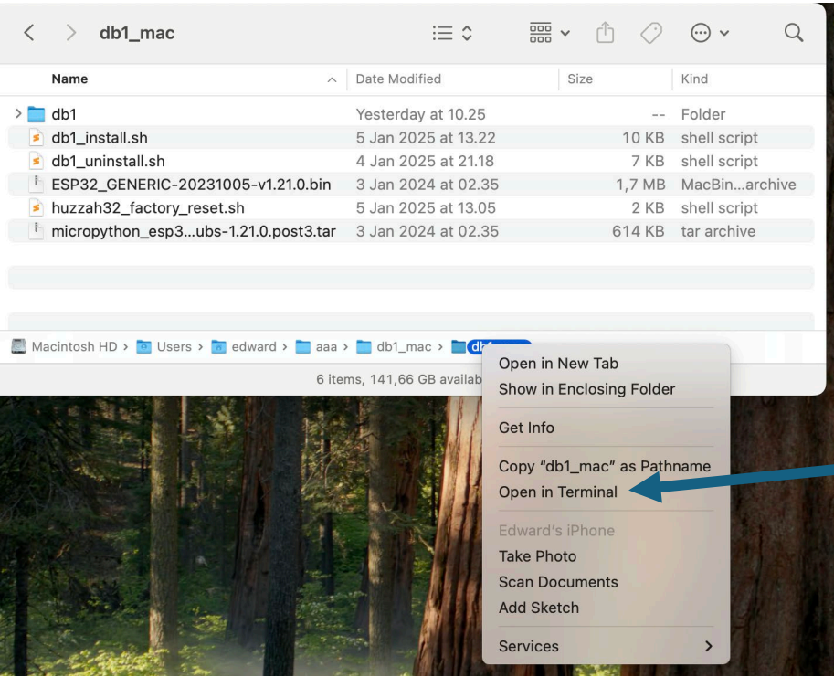

# Mac installation

You will find a zip file in this folder called db1_mac.zip. This file contains installation scripts that will help you set up an environment to program with your HUZZAH32 board, monitor it while it is running and eventually download measurement data from it. 

## Important considerations before installation

The installation script will setup the working environment within itself. This is where you will send your programs to the device from and download the data from it. In other words, where you start your installation is where you will be working from for the rest of the course. If you start installation from your "Downloads" folder, that is where you will be working from onwards. 

When choosing where you want to work from, ensure that there are no blank spaces in your path. The picture bellow are illustrative from a Windows computer, but apply on Mac as well. 


Content of the file 
After unzipping, you will find several scripts in the new folder. These are:

- db1_install.sh
- db1_uninstall.sh
- huzzah32_factory_reset.sh

You can ignore other files for now.

## Installation

Using Finder, go to the folder where you have downloaded the db1_mac.zip file. Typically it will be unzipped automatically, but in case it is not, double click on it and it should unzip then. Open the folder and find the installation scripts (see listed above). 

Once in the installation folder, double click on the bar at the bottom of the window showing the path. Right click on the db1_mac directory and from the resulting menu, select "Open in terminal" (see bellow). 



This will open the terminal window already in the directory where you can execute the installation scripts. You can execute the installation by running:

```{bash}
sudo bash db1_install.sh
```

You will be prompted for the user password to your Mac account to install the tools. This is because the necessary programs can only be installed with administrator rights. 

The installation can take several minutes, so be patient. At the end, you should be provided a list of the installed components and their status similar to the one shown bellow. If everything went well, the installation script will launch a Visual Studio Code instance with a default project that is present in the db1 subdirectory of your installation folder. You can close the VS Code for now. 

## Successful installation 

The installation script will also produce several log files in the same directory with the script that can help you figure out what the scripts are doing, and you can use them for getting help if you have trouble installing the tools. 

---

## HUZZAH32 factory reset
Next you can connect the Huzzah board to the computer run the factory reset on your HUZZAH32 board with the following command.

This will only work if your device is connected to your computer with a USB cable

```{bash}
bash huzzah32_factory_reset.sh
``` 

The serial port with HUZZAH32 may look as follows: 

- /dev/tty.usbserial-1234ABCD
    - where the text after usbserial is anid for the board and it’s board specific
- dev/tty.SLAB_USBtoUART 

If the reset script does not detect the serial port for the huzzah board, it's either because it was not connected properly or it's missing the appropriate drivers. 

If you are having issues connecting to your board, try downloading and installing the appropriate drivers from here: CP210x USB to UART Bridge VCP Drivers - Silicon Labs.

## Using VS Code

After successfully completing a factory reset of your HUZZAH32 board, you can start Visual Studio Code again. You might need to change your workspace folder in File>Open folder and find a DB1 folder within your installation folder. This will be a workspace where you will place scripts that are to be uploaded to your HUZZAH32 board. 

When changing into your installation folder, you might be shown the following message. You can tick the checkbox to avoid it appearing every time you open this folder in VS Code and then proceed to click on "Yes, I trust the authors".  

Trust authors