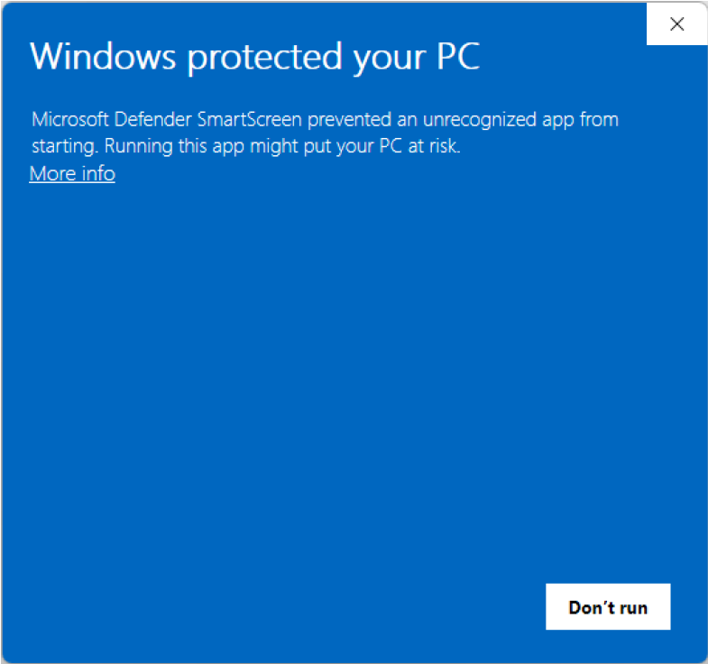
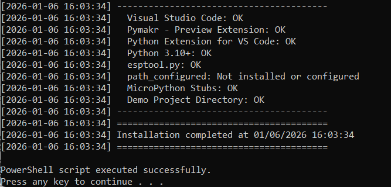
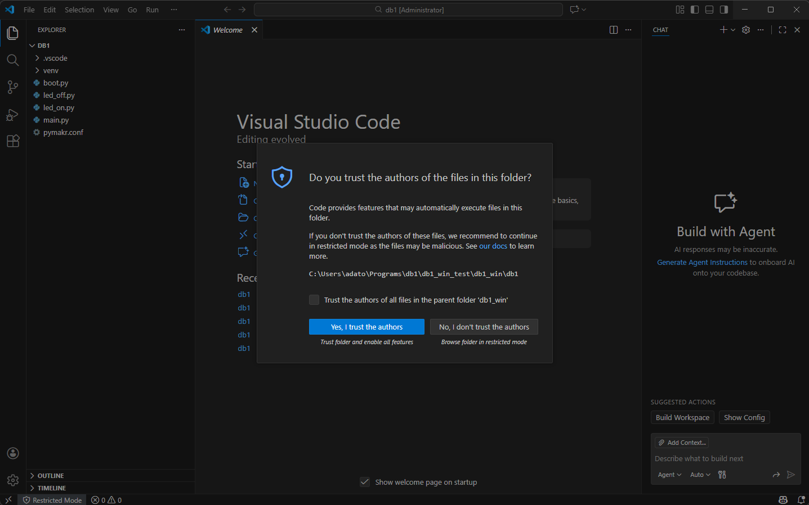

# Windows installation

You will find a zip file in this folder called db1_win.zip. This file contains installation scripts that will help you set up an environment to program with your HUZZAH32 board, monitor it while it is running and eventually download measurement data from it.

## Important considerations before installation

The installation script will setup the working environment within itself. This is where you will send your programs to the device from and download the data from it. In other words, where you start your installation is where you will be working from for the rest of the course. If you start installation from your "Downloads" folder, that is where you will be working from onwards.

When choosing where you want to work from, ensure that there are no blank spaces in your path.

You can unzip and install directly in your `C:\Users\<user>\` location or `C:\Users\Public` in your computer.

Content of the file

After unzipping, you will find several scripts in the new folder. These are:

- db1_install.bat
- db1_uninstall.bat
- huzzah32_factory_reset.bat

You can ignore other files for now.

## Installation

Install the necessary programs by right clicking on db1_install.bat and choosing Run as administrator.

You might be warned by a Windows Defender system (see bellow). You can click on More info and select "Run anyway".

The installation can take several minutes to finish and at the end it should provide a list of installed components and their status (see bellow). If everything went well, the installation script will launch a Visual Studio Code instance with a default project that is present in the db1 subdirectory of your installation folder. You can close it for now.

The installation script will also produce several log files in the same directory with the script that can help you figure out what the scripts are doing, and you can use them for getting help if you have trouble installing the tools.

## HUZZAH32 factory reset

Next you connect the Huzzah board to the computer and execute the huzzah32_factory_reset.bat. This time you do not need to run it as an administrator, you can just double click on it.

The serial port with HUZZAH32 may look as follows:

Silicon Labs CP210x USB to UART Bridge (COM3)

Where the number after COM differ in your computer. Note the COM serial number in your case.

If the reset script does not detect the serial port for the huzzah board, it's either because it was not connected properly or it's missing the appropriate drivers.

If you are having issues connecting to your board, try downloading and installing the appropriate drivers from here: CP210x USB to UART Bridge VCP Drivers - Silicon Labs.

## Using VS Code

After successfully completing a factory reset of your HUZZAH32 board, you can start Visual Studio Code again. You might need to change your workspace folder in File Open folder and find a DB1 folder within your installation folder. This will be a workspace where you will place scripts that are to be uploaded to your HUZZAH32 board.

When changing into your installation folder, you might be shown the following message. You can tick the checkbox to avoid it appearing every time you open this folder in VS Code and then proceed to click on "Yes, I trust the authors". 

